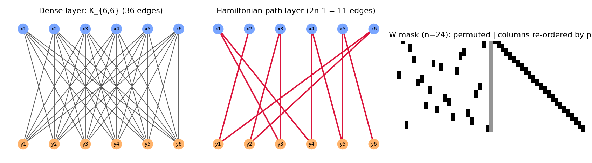
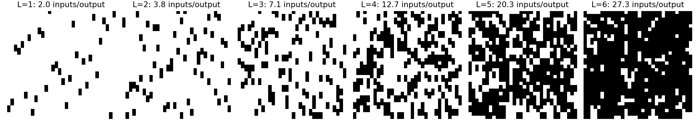
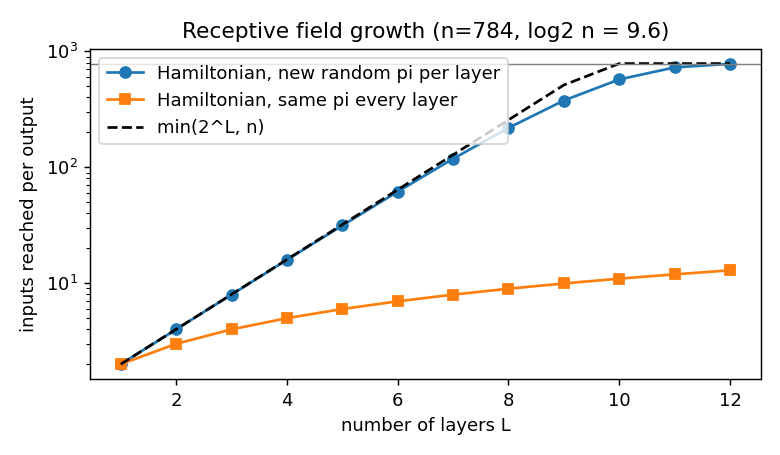
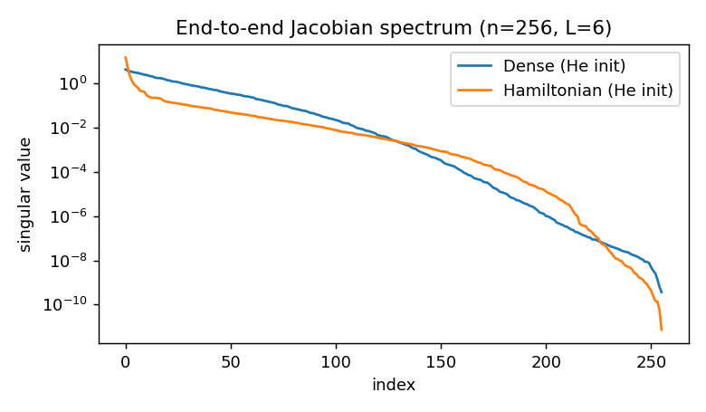
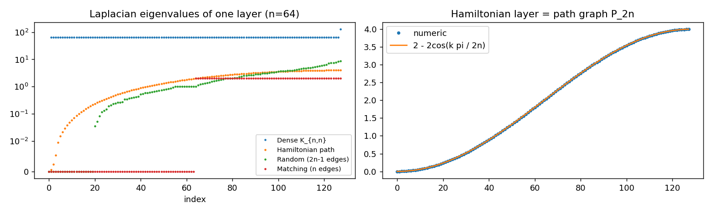
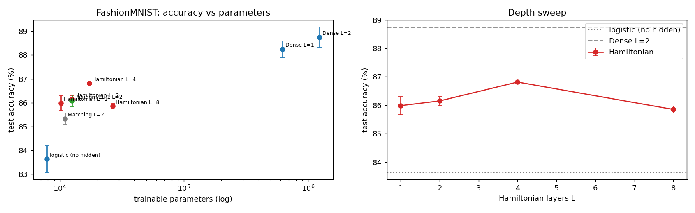
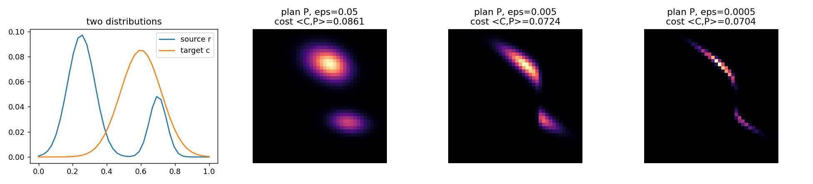
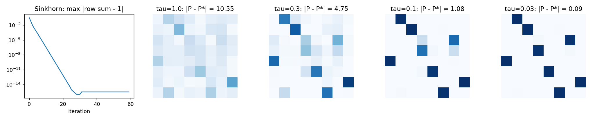
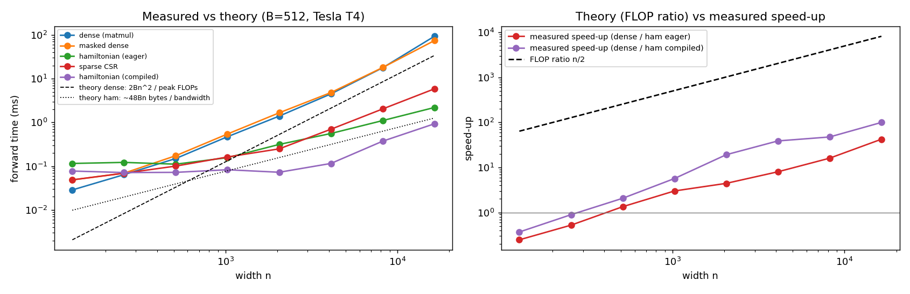
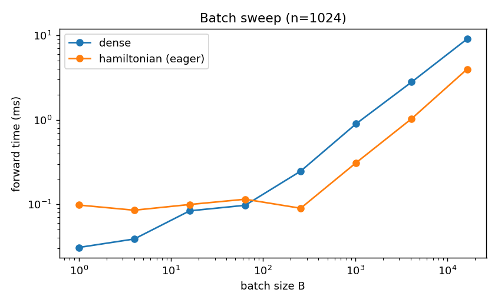

# 탐구노트: 해밀턴 경로로 연결한 은닉층

> 밀집층의 $n^2$개 연결을 **해밀턴 경로**($2n-1$개 간선)로 바꾸면 성능과 실행 시간은 어떻게 달라질까?
>
> - 실행 환경: Google Colab **Tesla T4 GPU**, PyTorch 2.11, 2026-10-15 실행
> - 데이터: FashionMNIST(옷 사진 10종, 학습 60,000장, 시험 10,000장), 10 epoch, 무작위 시드 3개(0, 1, 2)의 평균 ± 표준편차
> - 모든 숫자와 그림은 `hamiltonian_nn.ipynb` 실행 결과이다(`outputs/summary.md`, `outputs/results.json`).

---

## 0. 한눈에 보기

| 질문 | 답 (실행 결과) |
|---|---|
| 간선을 $n^2 \to 2n-1$로 줄여도 학습이 되는가? | **된다.** 해밀턴 층 4개: 정확도 **86.81%**, 파라미터 **17,258개**. 밀집층 2개는 88.75%, 1,238,730개이므로 파라미터 **1.4%** 로 1.9%p 차이 |
| 해밀턴 경로가 무작위 연결보다 나은가? | 그래프 구조는 확실히 다르다(해밀턴: 연결 성분 1개, 무작위: 20조각, 고립 뉴런 17개). 그런데 **정확도 차이는 거의 없었다**(86.15% vs 86.08%). 간선이 더 적은 매칭(85.33%)만 확실히 낮았다 |
| 직접 유도한 역전파는 맞는가? | **맞다.** 수치 미분 비교(gradcheck) 통과, 자동미분과 차이 0, 야코비안 = $W$ |
| 경로를 학습할 수 있는가? | 순열 하나는 **100%** 복원, 해밀턴 경로는 **45%** 만 복원. 실제 데이터에서도 학습한 경로(86.22%)가 무작위 경로(86.15%)보다 낫지 않았다 |
| 이론만큼 빨라지는가? | **아니다.** $n=16384$에서 이론(FLOP 비)은 8192배, 실제는 **42배**(커널 융합 시 100배). $n \le 256$에서는 오히려 **느렸다** |

---

## 1. 탐구 동기

- 지금까지는 이미 만들어진 AI 모델을 쓰거나 데이터를 바꿔 학습시키는 데 그쳤다. **구조 자체를 직접 설계해 보고 싶었다.**
- 고급 수학에서 **해밀턴 경로**(그래프의 모든 정점을 정확히 한 번씩 지나는 경로)를 배우면서, 신경망의 한 층도 '뉴런(정점)과 가중치(간선)로 이루어진 그래프'라는 점이 떠올랐다.
- 질문: **모든 뉴런을 빠짐없이, 하지만 최소한으로 잇는 연결**로 바꾸면 성능은 얼마나 떨어지고, 연산은 얼마나 줄어드는가?

---

## 2. 설계: 해밀턴 경로로 층 만들기

### 2-1. 신경망의 층 = 이분 그래프
층 하나는 입력 뉴런 $x_1,\dots,x_n$과 출력 뉴런 $y_1,\dots,y_n$을 잇는다. 정점이 두 무리로 나뉘고 간선은 항상 두 무리 사이에만 있으므로 **이분 그래프**다.
밀집층(dense layer)은 모든 입력과 모든 출력을 잇는 **완전 이분 그래프 $K_{n,n}$** 이고, 간선(=가중치) $W_{ij}$가 $n^2$개다.

$$y_i = \sum_{j=1}^{n} W_{ij}\, x_j + c_i \qquad (\text{곱셈 } n^2\text{번})$$

### 2-2. $K_{n,n}$ 위의 해밀턴 경로
이분 그래프에서 경로는 반드시 입력 → 출력 → 입력 → … 을 번갈아 지난다. 정점 $2n$개를 모두 한 번씩 지나려면 입력 쪽 순서를 순열 $\pi$로 정해

$$x_{\pi(1)} \to y_1 \to x_{\pi(2)} \to y_2 \to \cdots \to x_{\pi(n)} \to y_n$$

간선은 $2n-1$개이고, 출력 $y_k$는 경로에서 바로 앞뒤의 입력 두 개와만 연결된다.

$$\boxed{\,y_k = a_k\, x_{\pi(k)} + b_k\, x_{\pi(k+1)} + c_k \qquad (b_n = 0)\,}$$

학습할 값은 $a, b, c$ 세 벡터뿐이라 파라미터가 $n^2 + n \to 3n$으로 줄어든다.

- **왼쪽**: 밀집층 $K_{6,6}$, 간선 36개
- **가운데**: 해밀턴 경로 층, 간선 11개($=2\cdot6-1$). 빨간 선을 따라가면 모든 정점을 한 번씩 지난다.
- **오른쪽**: $n=24$일 때 가중치 행렬에서 0이 아닌 칸(검은색). 왼쪽 절반은 흩어져 보이지만, 열을 $\pi$ 순서로 다시 놓으면(오른쪽 절반) **대각선과 그 바로 위 대각선만 남는다** → 해밀턴 경로 층은 '순서를 바꾼 **이중대각 행렬**'이다. 행렬로 쓰면 $W = (D_a + D_b S)P_\pi$ ($P_\pi$: 순열행렬, $D_a = \mathrm{diag}(a)$, $S$: 한 칸 미는 행렬).

노트북에서 확인한 것: $n = 5, 64, 784$ 모두 간선 수가 정확히 $2n-1$이고, 모든 정점을 한 번씩 지나며, 최대 차수가 2였다.

| $n$ | 해밀턴 경로 층 간선 | 밀집층 간선 |
|---|---|---|
| 5 | 9 | 25 |
| 64 | 127 | 4,096 |
| 784 | 1,567 | 614,656 |

### 2-3. 설계하면서 내린 결정과 이유

| 결정 | 이유 |
|---|---|
| 출력 쪽 순서 $\sigma$는 없앰 | 활성화 함수는 원소마다 따로 작용하므로 순열과 순서를 바꿔도 같다: $\phi(Py) = P\phi(y)$. 층을 쌓으면 앞 층의 출력 순열과 다음 층의 입력 순열이 하나로 합쳐지므로, 층마다 순열 $\pi$ 하나면 충분하다 |
| 층마다 **다른** 무작위 순열 | 같은 순열을 쓰면 정보가 퍼지지 않는다(3-3절 수용 영역) |
| 은닉층 너비 = 784(입력 픽셀 수와 같게) | 처음에는 첫 층을 밀집층(784→n)으로 두었는데, 그 층이 거의 모든 일을 해서 은닉층 구조 차이가 보이지 않았다. 그래서 **입력 → [은닉층 784→784] × L → 출력(784→10)** 으로 바꿔 은닉층만 비교되게 했다 |
| 활성화 함수 GELU | ReLU는 입력이 2개뿐인 뉴런이 쉽게 '죽어서'(출력이 항상 0) 점검 실험에서 GELU보다 낮았다 |
| 초기화 $a, b \sim N(0,1)$ | 입력이 2개(fan-in = 2)이므로 He 초기화 규칙 $\mathrm{Var} = 2/\text{fan-in} = 1$ |
| 대조군 2개 | **무작위 연결**(간선 수 $2n-1$로 같음)과 **완전 매칭**(간선 $n$개, 입력 하나 ↔ 출력 하나). "해밀턴 경로라서 좋은 것인지, 그냥 간선이 적어서 그런지" 가르기 위해 |
| 구현: 행렬을 만들지 않음 | $u = x$를 $\pi$ 순서로 고르기(`index_select`) → 한 칸 밀기 → $a\odot u + b\odot(\text{밀린 }u) + c$. 메모리와 연산이 모두 $O(n)$ |

---

## 3. 역전파 수식 유도와 야코비안

### 3-1. 유도
표본 하나에 대해 $u_k = x_{\pi(k)}$, $v_k = u_{k+1}$($v_n = 0$), $y_k = a_k u_k + b_k v_k + c_k$로 두자.
손실 $L$에 대해 위층에서 $g_k = \partial L/\partial y_k$가 내려왔을 때, 연쇄법칙으로

$$\frac{\partial L}{\partial a_k} = \sum_{\text{batch}} g_k u_k,\qquad
\frac{\partial L}{\partial b_k} = \sum_{\text{batch}} g_k v_k,\qquad
\frac{\partial L}{\partial c_k} = \sum_{\text{batch}} g_k$$

핵심은 $u_k$가 **두 곳에 쓰인다**는 것이다. $y_k$에서는 계수 $a_k$로, $y_{k-1}$에서는 $v_{k-1} = u_k$이므로 계수 $b_{k-1}$로 쓰인다. 두 경로의 기울기를 더하면

$$\frac{\partial L}{\partial u_k} = a_k g_k + b_{k-1} g_{k-1}\quad(k \ge 2),\qquad \frac{\partial L}{\partial u_1} = a_1 g_1$$

마지막으로 $u = P_\pi x$였으므로 순서를 되돌린다: $\dfrac{\partial L}{\partial x} = P_\pi^\top \dfrac{\partial L}{\partial u}$, 즉 $\dfrac{\partial L}{\partial x_{\pi(k)}} = \dfrac{\partial L}{\partial u_k}$.

역전파도 원소별 곱셈과 순서 바꾸기뿐이라 **$O(n)$** 이다. 이 식을 `HamiltonianFn`(PyTorch `autograd.Function`)의 `backward`로 직접 구현했고, **실험의 모든 학습이 이 식으로 계산한 기울기로 진행됐다.**

### 3-2. 야코비안
야코비안 $J = \partial y / \partial x$의 $(k, \pi(k))$ 칸은 $a_k$, $(k, \pi(k+1))$ 칸은 $b_k$, 나머지는 0이다. 즉 **$J = W$** 이고 0이 아닌 칸이 $2n-1$개다. 역전파는 $\partial L/\partial x = J^\top g$를 계산하는 일이므로, 야코비안의 구조가 곧 역전파 비용을 결정한다.

### 3-3. 검증 결과

| 검증 | 방법 | 결과 |
|---|---|---|
| gradcheck | 중앙차분 $\frac{f(\theta+\varepsilon)-f(\theta-\varepsilon)}{2\varepsilon}$으로 구한 수치 미분과 직접 유도한 기울기를 double 정밀도로 비교 | **통과(True)** |
| 자동미분 비교 | PyTorch가 자동으로 계산한 기울기와 비교 | 최대 차이 **0.0** |
| 야코비안 | `torch.autograd.functional.jacobian`으로 구한 $J$와 $W$ 비교 ($n=12$) | **같음**, 0이 아닌 칸 **23개 = $2n-1$** |

### 3-4. 층을 쌓으면: 수용 영역이 $2^L$로 넓어진다
$L$층 전체의 야코비안은 $J = J_L \cdots J_2 J_1$이다. 행마다 0이 아닌 칸이 2개인 행렬을 $L$번 곱하므로, 출력 하나가 의존하는 입력 수(**수용 영역**)는 최대 $2^L$이다.

$n=32$일 때 전체 야코비안의 0이 아닌 칸(검은색). 층이 늘수록 2배씩 채워져 $L=5$에서 거의 꽉 찬다($\log_2 32 = 5$).

| 층 수 $L$ ($n=784$) | 1 | 2 | 3 | 4 | 5 | 6 | 7 | 8 | 9 | 10 | 11 | 12 |
|---|---|---|---|---|---|---|---|---|---|---|---|---|
| 출력 하나가 닿는 입력 수 | 2.0 | 4.0 | 8.0 | 15.9 | 31.4 | 61.6 | 118 | 218 | 376 | 572 | 726 | 779 |

- 층마다 **새 무작위 순열**을 쓰면 $L=7$까지 거의 정확히 $2^L$로 늘고, 그 뒤에는 이미 닿은 입력과 겹쳐서 증가가 느려진다. $\log_2 784 \approx 9.6$이지만 784개에 거의 다 닿으려면 약 12층이 필요했다.
- 모든 층에 **같은 순열**을 쓰면 수용 영역이 $L+1$개로만 늘었다(그림의 아래쪽 선). 층마다 순열을 바꿔야 하는 이유다.

### 3-5. 야코비안의 특잇값: 기울기 전달
초기화 직후 6층짜리 망($n=256$) 전체 야코비안의 특잇값을 비교했다.

| | 최대 특잇값 | 중앙값 | 거의 0($<10^{-6}$)인 비율 |
|---|---|---|---|
| 밀집층 | 4.42 | $2.64\times10^{-3}$ | 21% |
| 해밀턴 층 | **15.27** | $2.61\times10^{-3}$ | 16% |

해밀턴 망은 몇 개의 방향만 아주 크게(최대 15배) 늘리고, 나머지는 빠르게 작아진다. 즉 **기울기가 특정 방향에 쏠린다.** 층이 깊어질수록 이 쏠림이 커지므로, 깊게 쌓았을 때 학습이 어려워지는 원인 중 하나일 수 있다(5절의 $L=8$ 결과). 다만 이것은 가능성이고 직접 확인한 것은 아니다.

---

## 4. 왜 해밀턴 경로인가: 라플라시안 행렬

### 4-1. 라플라시안이란
그래프의 **라플라시안** $L = D - A$ ($D$: 각 정점의 차수를 대각에 놓은 행렬, $A$: 인접행렬)는 연결 구조를 고윳값으로 요약한다.

- 고윳값은 모두 0 이상이고, **고윳값 0의 개수 = 연결 성분(조각)의 개수**이다.
- 두 번째로 작은 고윳값 $\lambda_2$를 **대수적 연결도**(Fiedler 값)라 한다. $\lambda_2 > 0$이면 그래프 전체가 하나로 연결되어 있고, 클수록 정보가 빨리 퍼진다.

### 4-2. 한 층 비교 ($n = 64$, 정점 128개)

| 연결 | 간선 | 연결 성분 | $\lambda_2$ | 고립 뉴런 |
|---|---|---|---|---|
| 밀집 $K_{n,n}$ | 4,096 | 1 | **64.0** | 0 |
| **해밀턴 경로** | 127 | **1** | **0.00060** | **0** |
| 무작위 ($2n-1$개) | 127 | **20** | 0 | **17** |
| 매칭 ($n$개) | 64 | **64** | 0 | 0 |

- **왼쪽**: 네 가지 연결의 고윳값. 무작위·매칭은 0인 고윳값이 많다(= 여러 조각으로 끊어짐).
- **오른쪽**: 해밀턴 경로 층은 정점 $2n$개를 일렬로 이은 **경로 그래프 $P_{2n}$** 과 같다. 경로 그래프의 고윳값 공식 $\mu_k = 2 - 2\cos\frac{k\pi}{2n}$ ($k = 0, \dots, 2n-1$)과 수치 계산 결과가 **정확히 일치했다**. $\lambda_2 = 2 - 2\cos\frac{\pi}{128} \approx 0.00060$.
- 밀집층의 $\lambda_2 = n = 64$도 완전 이분 그래프의 이론값과 같다.

**정리**: 정점 $2n$개를 하나로 연결하려면 간선이 최소 $2n-1$개 필요하다(**신장 트리**). 해밀턴 경로는

1. 이 **최소 간선 수로 연결**을 이루고,
2. 모든 뉴런의 차수가 1~2로 고르다(**쉬는 뉴런도, 과부하된 뉴런도 없다**).

즉 해밀턴 경로 = **최대 차수가 2인 신장 트리**다. 같은 $2n-1$개 간선이라도 무작위로 뽑으면 20조각으로 끊어지고, 어떤 간선도 없는 고립 뉴런이 17개(약 13%) 생겼다.
13%라는 값은 확률로도 설명된다. 간선 $2n-1 \approx 2n$개를 무작위로 뽑을 때 한 입력 뉴런이 하나도 뽑히지 않을 확률은 $\left(1-\frac1n\right)^{2n} \approx e^{-2} \approx 13.5\%$이다.

### 4-3. 여러 층을 쌓았을 때 ($n = 64$)

| 층 수 $L$ | 해밀턴: 성분 / $\lambda_2$ | 무작위: 성분 / 고립 뉴런 | 매칭: 성분 |
|---|---|---|---|
| 1 | 1 / 0.0006 | 20 / 17 | 64 |
| 2 | 1 / 0.102 | 15 / 14 | 64 |
| 4 | 1 / 0.282 | 21 / 19 | 64 |
| 8 | 1 / 0.237 | 27 / 25 | 64 |

해밀턴 층은 몇 층을 쌓아도 하나로 연결되어 있다. 무작위 연결은 층을 쌓아도 끊어진 조각과 고립 뉴런이 계속 남는다. 매칭은 층마다 1:1로만 이어지므로 항상 64개의 독립된 줄로 나뉜다.

---

## 5. 실험 1: 성능 비교 (FashionMNIST)

**모델**: 입력(784픽셀) → [은닉층 784→784 + GELU] × $L$ → 출력층 784→10 (출력층은 모두 밀집층)
**학습**: Adam, 학습률 0.002, 배치 256, 10 epoch, 시드 3개

| 모델 | 정확도(%) | 파라미터 | 에폭당 시간(s) |
|---|---|---|---|
| 은닉층 없음 (로지스틱 회귀) | 83.64 ± 0.56 | 7,850 | 0.23 |
| 밀집 L=1 | 88.25 ± 0.35 | 623,290 | 0.29 |
| 밀집 L=2 | **88.75 ± 0.42** | 1,238,730 | 0.34 |
| 해밀턴 L=1 | 85.98 ± 0.32 | 10,202 | 0.38 |
| 해밀턴 L=2 | 86.15 ± 0.15 | 12,554 | 0.52 |
| 해밀턴 L=4 | **86.81 ± 0.03** | 17,258 | 0.77 |
| 해밀턴 L=8 | 85.85 ± 0.12 | 26,666 | 1.14 |
| 무작위 $2n-1$, L=2 | 86.08 ± 0.24 | 12,552 | 0.37 |
| 매칭, L=2 | 85.33 ± 0.22 | 10,986 | 0.38 |

(파라미터 계산 예: 해밀턴 L=2 = 층당 $3 \times 784 = 2{,}352$개 × 2층 + 출력층 $784 \times 10 + 10 = 7{,}850$개 = 12,554개)

- **왼쪽**: 가로축이 파라미터 수(로그 눈금), 세로축이 정확도. 해밀턴 층(빨강)은 파라미터가 밀집층(파랑)의 약 1/100인 왼쪽에 모여 있다.
- **오른쪽**: 해밀턴 층 수에 따른 정확도. 위 점선이 밀집 L=2, 아래 점선이 은닉층 없음.

### 해석

1. **간선 $2n-1$개짜리 층도 쓸모 있는 특징을 만든다.** 해밀턴 층 하나만 넣어도 은닉층 없는 모델보다 **+2.3%p**(83.64 → 85.98)였다. 출력 하나가 입력 두 개만 보지만, GELU를 거치며 '두 픽셀의 비선형 조합'이라는 새 특징이 생긴다.
2. **효율**: 해밀턴 L=4는 밀집 L=2보다 **1.9%p 낮지만 파라미터는 1.4%** 이다. 은닉층 없는 모델과 비교하면 파라미터 9,408개를 더해 3.2%p를 올렸고, 밀집 L=2는 약 123만 개를 더해 5.1%p를 올렸다.
3. **깊이**: $L = 1 \to 2 \to 4$로 늘리면 정확도가 올랐고(수용 영역이 2 → 4 → 16개 입력으로 넓어짐), $L=4$는 시드 간 편차도 0.03으로 가장 안정적이었다. 그런데 $L=8$에서는 85.85%로 **오히려 떨어졌다.** 수용 영역은 218개 입력까지 넓어지지만, 출력층으로 가는 경로가 길어지면서 기울기가 쏠리거나 약해져(3-5절) 학습이 어려워진 것으로 생각한다. **표현할 수 있는 것과 학습할 수 있는 것은 다르다.**
4. **대조군 — 예상과 다른 결과**: 라플라시안으로 보면 무작위 연결은 끊어진 그래프인데, 정확도는 해밀턴 L=2와 거의 같았다(86.08 vs 86.15, 표준편차 범위 안). 내가 생각하는 이유는 세 가지다.
   - 출력층이 **밀집층**이라 784개 은닉 뉴런을 모두 본다. 그래서 은닉층이 끊어져 있어도 출력층에서 다시 합쳐진다.
   - 고립된 입력 뉴런(약 13%)은 그 픽셀을 버리는 것과 같다. 그런데 FashionMNIST는 가장자리 배경 픽셀처럼 정보가 거의 없거나 이웃과 겹치는 픽셀이 많아서 손해가 작았을 수 있다.
   - 무작위 연결에서는 어떤 출력 뉴런은 입력을 3~5개 받는다. 이런 뉴런이 더 복잡한 조합을 만들어 손해를 메웠을 수 있다.

   간선이 $n$개뿐인 **매칭**은 확실히 낮았다(85.33%). 매칭은 출력 하나가 입력 하나만 보므로 '픽셀마다 따로 비선형 변환'만 할 수 있고, 픽셀끼리 섞이지 않는다. 연결로 정보를 섞는 것이 성능에 중요하다는 증거다.
   결론적으로, **이 실험(L=2, 밀집 출력층)에서는 해밀턴 경로의 '연결성 보장'이 정확도 이득으로 나타나지 않았다.** 해밀턴 경로의 장점은 정확도보다 **모든 뉴런이 쓰인다는 보장과 규칙적인 구조**(6절의 빠른 구현이 가능한 이유)에 있다.

5. **학습 시간은 해밀턴 쪽이 더 길었다**(L=2: 0.52초 vs 밀집 0.34초). 이유는 7절에서 설명한다($n=784$는 GPU에서 해밀턴 층이 아직 이득을 못 보는 크기다).

---

## 6. 순열을 학습하기: 이중확률행렬, 최적 운송, 싱크혼

### 6-1. 문제: 순열은 미분할 수 없다
지금까지 순열 $\pi$는 무작위로 정했다. 더 좋은 경로를 **학습**하고 싶지만, 순열은 $n!$개 중 하나를 고르는 이산적인 선택이라 기울기로 조금씩 바꿀 수 없다.

### 6-2. 버코프–폰 노이만 정리: 순열을 연속으로 늘리기
**이중확률행렬**: 모든 성분이 0 이상이고, 모든 행의 합과 모든 열의 합이 1인 행렬. 순열행렬도 이중확률행렬이다.
**버코프 정리**: 이중확률행렬 전체의 집합(버코프 다면체)은 **순열행렬들의 볼록 결합**이고, 그 꼭짓점이 정확히 순열행렬이다.
→ 꼭짓점(순열) 사이를 뛰어다니는 대신 다면체 **안에서 연속적으로 움직이며 학습**하다가, 마지막에 가장 가까운 꼭짓점으로 내려앉히면 된다.

**직접 확인**: 싱크혼으로 만든 $5\times5$ 이중확률행렬을 실제로 분해했더니 **순열행렬 17개**의 가중합이 되었다. 가중치 합은 1.000000, 복원 오차는 $1.9\times10^{-16}$이었다. 분해할 때는 매번 0이 아닌 칸만 지나는 순열을 하나 찾아 빼냈다. 이런 순열이 항상 존재한다는 것은 홀의 결혼 정리로 보장된다.

### 6-3. 싱크혼 정리
성분이 모두 양수인 정사각행렬 $A$에 대해, 양의 대각행렬 $D_1, D_2$가 존재해서 $D_1 A D_2$가 이중확률행렬이 된다(상수배를 빼면 유일). 그리고 **"각 행을 행의 합으로 나누기 → 각 열을 열의 합으로 나누기"를 번갈아 반복**하면 그 행렬로 수렴한다.

### 6-4. 최적 운송과의 관계
분포 $r$을 분포 $c$로 옮길 때, $i$에서 $j$로 한 단위 옮기는 비용이 $C_{ij}$라면 가장 싼 운송 계획 $P$를 찾는 문제가 **최적 운송**이다. 여기에 엔트로피 항을 더하면

$$\min_{P\ge0,\ P\mathbf 1 = r,\ P^\top \mathbf 1 = c}\ \langle C, P\rangle - \varepsilon H(P),\qquad H(P) = -\sum_{ij}P_{ij}(\log P_{ij}-1)$$

**유도**: 행 제약에 라그랑주 승수 $f_i$, 열 제약에 $g_j$를 붙여 $P_{ij}$로 미분하면

$$C_{ij} + \varepsilon\log P_{ij} - f_i - g_j = 0
\;\Longrightarrow\;
P_{ij} = e^{f_i/\varepsilon}\; e^{-C_{ij}/\varepsilon}\; e^{g_j/\varepsilon}
\;\Longrightarrow\;
P = \mathrm{diag}(u)\,K\,\mathrm{diag}(v),\quad K = e^{-C/\varepsilon}$$

이것이 바로 싱크혼 정리의 $D_1 A D_2$ 꼴이다. 제약을 맞추는 $u, v$는 $u \leftarrow r/(Kv)$, $v \leftarrow c/(K^\top u)$를 번갈아 반복해 구한다(= 행·열 정규화 반복).

- $r = c = \mathbf 1$이면 $P$는 이중확률행렬이다.
- $\varepsilon \to 0$이면 엔트로피 항이 사라져 $P$는 $\langle C, P\rangle$를 최소로 하는 **순열행렬**(선형 할당 문제의 해)에 다가간다.
- 신경망에서는 학습 가능한 점수 행렬 $\theta$를 $-C$로, 온도 $\tau$를 $\varepsilon$으로 쓴다. '입력 뉴런을 경로의 각 위치로 옮기는 운송 계획'을 학습하는 셈이다.

**예시: 1차원 분포 옮기기** (비용 = 거리의 제곱)

| $\varepsilon$ | 수렴까지 반복 횟수 | 운송 비용 $\langle C,P\rangle$ |
|---|---|---|
| 0.05 | 26 | 0.0861 |
| 0.005 | 264 | 0.0724 |
| 0.0005 | 2,254 | 0.0704 |

$\varepsilon$이 작을수록 운송 계획이 흐릿한 띠에서 날카로운 선(정확한 1:1 대응)으로 바뀌고 비용도 줄지만, **수렴에 필요한 반복이 약 10배씩** 늘어난다. 정확도와 계산량 사이의 교환 관계다.

### 6-5. 싱크혼의 역전파 유도
수치가 넘치지 않도록 로그 영역에서 계산한다. 행 정규화 한 번은 $\ell'_{ij} = \ell_{ij} - \log\sum_k e^{\ell_{ik}}$이고, $Q_{ij} = e^{\ell'_{ij}}$(각 행의 합이 1)라 하면

$$\frac{\partial \ell'_{ij}}{\partial \ell_{ab}} = \delta_{ia}\left(\delta_{jb} - Q_{ab}\right)
\quad\Longrightarrow\quad
\frac{\partial L}{\partial \ell_{ab}} = G_{ab} - Q_{ab}\sum_j G_{aj}\qquad\left(G = \frac{\partial L}{\partial \ell'}\right)$$

이것은 **소프트맥스의 야코비안**과 같은 꼴이다. 열 정규화는 전치해서 같은 식을 쓰고, 싱크혼 전체의 역전파는 이 식을 거꾸로 반복하면 된다. `LogNormalize`의 `backward`로 직접 구현해 확인했다.

- `LogNormalize` gradcheck: **통과**
- 싱크혼 5회 반복 전체 gradcheck: **통과**

### 6-6. 수렴과 온도

- **맨 왼쪽**: 반복할수록 행 합의 오차가 일정한 비율로 줄어(로그 눈금에서 직선 = **선형 수렴**) 약 25번 만에 컴퓨터 정밀도 한계($10^{-15}$)에 도달했다.
- **나머지 4개**: 같은 점수 행렬에서 온도 $\tau$를 낮추면 이중확률행렬이 헝가리안 알고리즘의 답 $P^*$(순열행렬)에 다가간다. $|P - P^*|$ = 10.55 → 4.75 → 1.08 → **0.09**.

---

## 7. 실험 2: 해밀턴 경로를 학습하기

학습 중에는 순열 대신 $\tilde P = \mathrm{Sinkhorn}(\theta/\tau)$를 쓰고($u = \tilde P x$), 온도 $\tau$를 1에서 0.03까지 낮춘다. 끝나면 $\theta$에 **헝가리안 알고리즘**(선형 할당 문제를 푸는 방법)을 적용해 가장 가까운 순열을 고르고(**경화**), 보통의 해밀턴 층으로 바꾼다. 학습할 때는 $O(n^2)$이지만, 추론할 때는 다시 $O(n)$이다.

### 7-1. 장난감 문제: 숨겨진 순열을 되찾을 수 있는가? ($n=16$, 시드 6개)
정답 층(teacher)이 만든 입력–출력 쌍만 보고 학생 층이 정답 순열을 맞히게 했다.

| 정답의 형태 | 순열 복원율 (시드 6개) | 평균 | 최종 손실 |
|---|---|---|---|
| (가) 순열 하나: $y = P_\pi x$ | 1.00, 1.00, 1.00, 1.00, 1.00, 1.00 | **100%** | 0.000 |
| (나) 해밀턴 경로 층 | 0.50, 0.38, 0.50, 0.56, 0.44, 0.31 | **45%** | 0.08 ~ 0.51 |

**왜 (나)는 실패하는가**: (가)는 '입력 $j$가 출력 몇 번으로 가는가'만 맞히면 되는, 볼록 문제에 가까운 쉬운 문제다. (나)에서는 경로의 이웃한 두 출력 $y_k$와 $y_{k+1}$이 같은 입력 $x_{\pi(k+1)}$을 **공유**한다. 그래서 한 행의 확률을 두 위치에 반씩 나눠 거는 이중확률행렬 같은 **국소 최솟값**이 생기고, 손실이 0까지 내려가지 못한다(최종 손실 0.08~0.51).
해밀턴 경로를 고르는 것은 본질적으로 **외판원 문제(TSP)** 처럼 '순서'를 정하는 조합 최적화 문제다. 순열 하나를 고르는 할당 문제(다항 시간에 풀림)보다 근본적으로 어렵다는 점과 연결된다.

### 7-2. FashionMNIST에서 경로 학습 (L=2)
9 epoch 동안 싱크혼으로 학습 → 경화 → 순열을 고정하고 1 epoch 미세조정. 무작위 순열 해밀턴 층은 같은 10 epoch 동안 학습했다.

| 시드 | 학습 중(soft) | 경화(hard) | 미세조정 후 | 무작위 순열 | $\tilde P$ 날카로움 |
|---|---|---|---|---|---|
| 0 | 86.75 | 81.40 | 86.48 | 85.94 | 0.916 |
| 1 | 86.94 | 79.50 | 85.91 | 86.28 | 0.909 |
| 2 | 86.99 | 81.15 | 86.28 | 86.23 | 0.921 |
| **평균** | **86.89** | **80.68** | **86.22** | **86.15** | **0.915** |

($\tilde P$ 날카로움 = 각 행의 최댓값 평균. 1이면 완전한 순열이다.)

**설계하면서 바꾼 것** (점검 실험에서의 시행착오)

- $\theta$를 거의 0으로 시작하면 $\tilde P$가 모든 칸이 $1/n$인 '평균 내기' 행렬이 되어 학습이 안 됐다(정확도 23%). → **무작위 순열에서 출발**하게 바꿨다.
- $\theta$는 순열을 바꿀 만큼 크게 움직여야 하므로 다른 파라미터보다 큰 학습률(0.05)을 줬다.

**해석**

1. **학습 중(soft) 정확도가 무작위보다 0.7%p 높았지만**, 이것은 경로를 잘 찾아서가 아니다. $\tilde P$가 완전한 순열이 아니라서(날카로움 0.915) 출력 하나가 실제로는 입력 여러 개를 섞어 본다. 즉 $O(n^2)$짜리 더 큰 모델이었기 때문이다.
2. **경화하면 6.2%p 떨어졌다**(86.89 → 80.68). 남아 있던 약 8.5%의 '섞기'가 사라지면서, 그에 맞춰 학습된 $a, b$와 출력층이 맞지 않게 되었기 때문이다.
3. **1 epoch 미세조정으로 86.22%까지 회복**했지만, 무작위 순열(86.15%)과 거의 같다. 이 실험 조건에서는 **학습한 경로가 무작위 경로보다 낫지 않았다.**
   - 5절에서 본 것처럼 출력층이 밀집층이라 경로를 어떻게 정하든 결국 다시 섞이고, $a, b$와 출력층이 주어진 순열에 맞춰 적응한다. 그래서 '어떤 경로인가'의 영향이 원래 작았던 것으로 보인다.
   - 장난감 문제에서 본 국소 최솟값 문제도 있다.

---

## 8. 실험 3: 연산 효율 — 이론과 실측

### 8-1. 이론 (배치 $B$, 너비 $n$, 32비트 실수)

| | 밀집층 | 해밀턴 층 |
|---|---|---|
| 파라미터 | $n^2 + n$ | $3n$ |
| 연산량(FLOP) | $2Bn^2$ | 약 $4Bn$ → 비율 $n/2$ |
| 메모리 읽기·쓰기 | 약 $4(2Bn + n^2)$ 바이트 | 연산마다 $B\times n$ 텐서를 읽고 써서 약 $48Bn$ 바이트 |
| **산술 강도** (바이트당 연산 수) | 수백 (계산이 병목) | 약 0.1 (**메모리가 병목**) |

GPU 실행 시간은 대략 다음 셋으로 정해진다: ① 연산량 ÷ 최대 연산 속도, ② 데이터량 ÷ 메모리 대역폭, ③ 커널 실행 비용 × 커널 수.
T4는 최대 약 8.1 TFLOP/s, 메모리 약 320 GB/s다. 따라서 산술 강도가 $8.1\times10^{12} / 320\times10^9 \approx 25$보다 작은 연산은 메모리 속도에 묶인다.
(**커널** = GPU에 한 번 내리는 작업 단위. 하나를 띄울 때마다 수 μs의 고정 비용이 든다.)

### 8-2. 측정: 너비 $n$에 따른 순전파 시간 ($B = 512$)

| $n$ | 밀집 | 마스크 밀집 | 해밀턴(eager) | 희소 CSR | 해밀턴(커널 융합) | 실제 가속 (eager) | FLOP 비 $n/2$ |
|---|---|---|---|---|---|---|---|
| 128 | 0.029 ms | 0.049 | 0.115 | 0.049 | 0.077 | **0.25** | 64 |
| 256 | 0.064 | 0.069 | 0.122 | 0.069 | 0.072 | **0.52** | 128 |
| 512 | 0.150 | 0.174 | 0.111 | 0.100 | 0.072 | 1.35 | 256 |
| 1024 | 0.471 | 0.544 | 0.157 | 0.162 | 0.083 | 3.0 | 512 |
| 2048 | 1.396 | 1.660 | 0.314 | 0.249 | 0.073 | 4.4 | 1,024 |
| 4096 | 4.491 | 4.820 | 0.559 | 0.699 | 0.115 | 8.0 | 2,048 |
| 8192 | 17.75 | 18.00 | 1.102 | 2.034 | 0.373 | 16.1 | 4,096 |
| 16384 | 93.11 | 74.28 | 2.194 | 5.856 | 0.930 | **42.4** | 8,192 |

- 해밀턴(eager) = PyTorch 기본 연산을 이어 붙인 구현
- 커널 융합 = `torch.compile`로 여러 연산을 커널 하나로 합친 구현
- 마스크 밀집 = 밀집 행렬에 0/1 마스크를 곱한 구현
- 희소 CSR = 범용 희소 행렬 라이브러리(cuSPARSE)

- **왼쪽**: 실측 시간(점)과 이론 예측(검은 점선 = 밀집 $2Bn^2$ ÷ 최대 연산 속도, 점 선 = 해밀턴 $48Bn$ 바이트 ÷ 대역폭). $n$이 클 때 밀집은 $n^2$ 기울기로, 해밀턴은 $n$ 기울기로 늘어나 이론과 모양이 같다.
- **오른쪽**: 실제 가속(빨강: eager, 보라: 커널 융합)과 이론 FLOP 비(검은 점선). 실제 가속은 이론보다 **약 200배 작다.** 해밀턴(eager)은 $n=512$부터 밀집층보다 빨라졌다.

**GPU가 얼마나 일하고 있었나**

| $n$ | 128 | 512 | 1024 | 4096 | 8192 | 16384 |
|---|---|---|---|---|---|---|
| 밀집층 연산 속도 (GFLOP/s) | 587 | 1,792 | 2,278 | 3,826 | 3,872 | 2,952 |
| 밀집층 활용률 (최대 대비) | 7% | 22% | 28% | 47% | **48%** | 36% |
| 해밀턴 유효 메모리 속도 (GB/s) | 27 | 113 | 161 | 180 | 183 | **184** |

### 8-3. 커널 수 (프로파일러, $n=1024$)

| 구현 | GPU 커널 수 |
|---|---|
| 밀집층 | **2** (행렬곱 + 편향 더하기) |
| 해밀턴(eager) | **7** (고르기, 밀기, 곱하기 ×2, 더하기 ×2 …) |
| 해밀턴(커널 융합) | **1** |

### 8-4. 배치 크기 바꾸기 ($n = 1024$)

| 배치 $B$ | 1 | 4 | 16 | 64 | 256 | 1024 | 4096 | 16384 |
|---|---|---|---|---|---|---|---|---|
| 밀집 (ms) | 0.031 | 0.039 | 0.084 | 0.097 | 0.247 | 0.900 | 2.804 | 9.074 |
| 해밀턴 (ms) | 0.098 | 0.085 | 0.100 | 0.115 | 0.090 | 0.311 | 1.032 | 3.984 |
| 밀집, 표본 하나당 (μs) | 30.9 | 9.7 | 5.2 | 1.5 | 0.97 | 0.88 | 0.69 | 0.55 |

- 밀집층: 일이 64배($B$ = 1 → 64) 늘어도 시간은 약 3배만 늘었다. 표본 하나당 시간은 30.9μs에서 0.55μs로 **56배 효율적**이 되었다.
- 해밀턴 층: $B \le 256$까지 시간이 약 0.1ms로 거의 일정하다. **GPU의 수천 개 코어가 다 채워지지 않아, 계산이 아니라 커널 실행 비용이 시간을 결정하는 구간**이다.

### 8-5. 학습 한 단계(순전파+역전파)와 CPU 비교 ($B=512$)

| 장치 | $n$ | 밀집 (ms) | 해밀턴 (ms) | 실제 가속 | FLOP 비 |
|---|---|---|---|---|---|
| GPU | 256 | 0.613 | 1.378 | **0.45 (더 느림)** | 128 |
| GPU | 1024 | 0.739 | 0.926 | **0.80 (더 느림)** | 512 |
| GPU | 4096 | 13.09 | 1.298 | 10.1 | 2,048 |
| CPU | 256 | 2.42 | 1.22 | 2.0 | 128 |
| CPU | 1024 | 29.89 | 4.09 | 7.3 | 512 |
| CPU | 4096 | 484.7 | 21.30 | **22.8** | 2,048 |

### 8-6. 해석 (GPU 병렬성 관점)

1. **이론 8192배 → 실제 42배인 이유: 병목이 다르다.**
   - 밀집 행렬곱은 데이터 하나를 읽어 여러 번 계산에 재사용한다(산술 강도가 높음). 그래서 cuBLAS가 GPU 연산 장치를 최대 48%까지 썼다.
   - 해밀턴 층은 값을 읽어 한두 번 계산하고 버린다. 실효 메모리 속도가 약 184 GB/s(T4 최대의 57%)에서 더 늘지 않았으므로, **계산 속도가 아니라 메모리 대역폭에 묶여 있다.** 줄어든 것은 연산량인데, 시간을 결정하는 것은 메모리 이동량이라 이론만큼 줄지 않는다.
2. **작은 $n$에서 오히려 느린 이유: 커널 실행 비용.** 해밀턴(eager)은 $n \le 512$에서 $n$과 상관없이 약 0.11ms다. 실제 계산은 수 μs면 끝나는데, 커널을 7번 띄우는 고정 비용이 더 크다. 밀집층은 커널 2개라 작은 $n$에서 이긴다.
   - **검증**: 커널을 하나로 합쳤더니(`torch.compile`) 시간이 약 0.07ms로 줄었고, $n = 2048$까지도 거의 그대로였다. 이 구간의 시간은 거의 전부 커널 실행 비용이라는 뜻이다. 큰 $n$에서도 가속이 42배 → **100배**로 커졌다(메모리를 한 번만 읽고 쓰게 되므로).
3. **'희소하다' ≠ '빠르다'.** 마스크 밀집은 연결을 99.8% 없앴는데도 밀집층과 시간이 같거나 더 느렸다. 0인 칸도 똑같이 계산하기 때문이다. 범용 희소 행렬(CSR)은 빨라지긴 했지만, $n=16384$에서 전용 구현보다 2.7배 느렸다. CSR은 0이 아닌 칸의 위치를 따로 저장하고 읽어야 하지만, 전용 구현은 '행마다 정확히 2개, 바로 옆'이라는 **구조를 알기 때문에** 위치 정보가 필요 없다. 구조를 이용한 구현이 있어야 이득을 본다.
4. **학습은 순전파보다 더 늦게 이득을 본다.** 역전파까지 합치면 커널 수가 더 늘어나, GPU에서는 $n=1024$에서도 해밀턴이 느렸다(0.8배). 그래서 $n = 784$로 한 실험 1의 에폭당 시간도 해밀턴이 더 길었다.
5. **CPU에서는 이론에 더 가깝다.** $n=4096$에서 GPU는 10배, CPU는 23배 빨라졌다. CPU는 코어가 적어서 연산량이 시간에 더 직접 반영되고, 커널 실행 비용 같은 고정 비용도 작다. **병렬성이 낮은 환경(휴대폰, 작은 기기)일수록 연산량 감소의 효과가 크다.**
6. (참고) $n = 16384$에서 밀집층 활용률이 48% → 36%로 떨어졌고, 마스크 밀집(74ms)이 밀집(93ms)보다 빠르게 나왔다. 가중치 행렬 하나가 1GB에 이르는 크기라 측정 중 GPU 클럭 변화 같은 다른 요인이 섞였을 수 있다. 원인은 확인하지 않았다.

---

## 9. 결론

1. 은닉층 연결을 해밀턴 경로로 제한한 층을 설계했다. 파라미터는 $n^2 \to 3n$, 연산은 $O(n^2) \to O(n)$이다. FashionMNIST에서 **밀집층 파라미터의 1.4%로 정확도 86.81%** (밀집층 88.75%)를 얻었다.
2. 라플라시안 분석으로 해밀턴 경로는 **최소 간선($2n-1$)으로 모든 뉴런을 연결하는 구조**(경로 그래프 $P_{2n}$, $\lambda_2 > 0$)임을 확인했다. 하지만 출력층이 밀집층인 이번 설정에서는 이 연결성이 무작위 연결 대비 **정확도 이득으로 이어지지 않았다.** 정보를 섞지 못하는 매칭보다는 확실히 나았다.
3. 역전파를 직접 유도해 구현했고, gradcheck·자동미분·야코비안 세 방법으로 검증했다. 야코비안의 곱으로 수용 영역이 $2^L$로 넓어짐을 보였다.
4. 순열을 버코프 다면체(이중확률행렬)로 완화하고, 엔트로피 최적 운송의 해가 싱크혼 형태임을 유도했다. 싱크혼의 역전파도 유도해 학습에 썼다. 순열 하나는 완벽히 학습되지만, 해밀턴 경로는 이웃이 입력을 공유하는 구조 때문에 국소 최솟값에 빠졌다(45%).
5. 이론 연산량과 실제 GPU 시간은 크게 달랐다(8192배 vs 42배, 작은 $n$에서는 더 느림). 원인은 **메모리 대역폭 병목과 커널 실행 비용**이었고, 커널 융합으로 100배까지 개선됨을 확인했다. **"연산량이 줄면 빨라진다"는 하드웨어가 그 구조를 잘 활용할 때만 성립한다.**

## 10. 한계와 후속 탐구

- **데이터와 구조의 한계**: FashionMNIST 한 가지, 출력층은 밀집층으로만 실험했다. 출력층까지 희소하게 만들거나 더 큰 데이터에서 실험하면, 해밀턴 경로의 연결성 보장이 정확도 차이로 나타나는지 확인할 수 있다.
- **깊이 문제**: $L=8$에서 성능이 떨어졌다. 잔차 연결($h + \phi(\cdot)$), 정규화, 더 나은 초기화로 개선해 볼 수 있다. (점검 실험에서 단순한 잔차 연결은 오히려 나빴으므로 초기화를 함께 바꿔야 할 것이다.)
- **경로 학습**: 여러 번 다시 시작하기, Gumbel 잡음 추가, 경로를 직접 탐색하는 조합 최적화 방법을 시도해 볼 수 있다.
- **진짜 속도 이득**: 순전파와 역전파 전체를 커널 하나로 만드는 전용 GPU 커널(Triton/CUDA)을 직접 짜 볼 수 있다.
- **찾아본 관련 연구**
  - 구조적 희소 행렬로 밀집층 대체: Butterfly 행렬(Dao 외, ICML 2019), Monarch 행렬(Dao 외, ICML 2022). 해밀턴 층처럼 '순서 바꾸기 + 단순한 행렬'을 여러 번 곱하는 구조다.
  - 그래프 이론으로 희소 연결 설계: Deep Expander Networks(Prabhu 외, ECCV 2018)
  - 싱크혼으로 순열 학습: Gumbel-Sinkhorn(Mena 외, ICLR 2018). 엔트로피 최적 운송과 싱크혼: Cuturi(NeurIPS 2013)

---

## 11. 면접 예상 질문과 답변

**Q1. 왜 해밀턴 경로를 신경망에 적용했나요?**
신경망의 한 층을 뉴런은 정점, 가중치는 간선으로 보면 그래프가 되고, 밀집층은 모든 입력과 출력을 잇는 완전 이분 그래프입니다. 저는 모든 뉴런을 빠짐없이 쓰면서 연결은 최소로 하는 구조가 무엇일지 궁금했습니다. 고급 수학에서 배운 해밀턴 경로가 '모든 정점을 정확히 한 번씩 지난다'는 조건이라 그 답이 될 수 있다고 생각했습니다. 기존 모델을 쓰는 데서 그치지 않고 구조 자체를 설계해 보고 싶었던 것이 출발점이었습니다.

**Q2. 그 층을 수식으로 설명해 보세요.**
입력 $n$개, 출력 $n$개의 이분 그래프에서 해밀턴 경로는 입력과 출력을 번갈아 지나서 간선이 $2n-1$개입니다. 그래서 출력 하나는 경로에서 이웃한 입력 두 개와만 이어지고, $y_k = a_k x_{\pi(k)} + b_k x_{\pi(k+1)} + c_k$가 됩니다. 행렬로 쓰면 순서를 바꾼 이중대각 행렬이라 파라미터는 $n^2$에서 $3n$으로, 연산은 $O(n^2)$에서 $O(n)$으로 줄어듭니다. 출력 쪽 순서는 활성화 함수가 순열과 교환되기 때문에 다음 층의 순열에 합칠 수 있어서 없앴습니다.

**Q3. 성능은 어땠나요?**
FashionMNIST에서 해밀턴 층 4개가 86.81%, 밀집층 2개가 88.75%였습니다. 1.9%p 낮지만 파라미터는 1.4%(1만 7천 개 대 124만 개)입니다. 은닉층이 없는 모델(83.64%)보다는 3.2%p 높아서, 입력 두 개짜리 층으로도 쓸모 있는 특징을 만든다는 것을 확인했습니다. 다만 8층으로 늘리면 85.85%로 떨어졌습니다. 수용 영역은 넓어져도 기울기가 잘 전달되지 않으면 학습이 어려워진다는 것, 즉 표현할 수 있는 것과 학습할 수 있는 것이 다르다는 것을 배웠습니다.

**Q4. 간선 수만 같게 무작위로 연결하는 것과 뭐가 다른가요?**
라플라시안 행렬로 비교했습니다. 라플라시안의 고윳값 0의 개수는 연결 성분 수이고, 두 번째 고윳값 $\lambda_2$가 0보다 크면 연결되어 있다는 뜻입니다. $n=64$에서 해밀턴 경로는 연결 성분 1개, $\lambda_2 = 0.0006$으로 경로 그래프의 공식 $2-2\cos\frac{k\pi}{2n}$과 정확히 일치했습니다. 같은 수의 간선을 무작위로 뽑으면 20조각으로 끊어지고 고립 뉴런이 17개 생겼습니다. 이 약 13%는 $e^{-2}$로 확률적으로도 설명됩니다. 정점 $2n$개를 연결하는 최소 간선 수가 $2n-1$이므로, 해밀턴 경로는 최소 간선으로 연결을 보장하는 '최대 차수 2인 신장 트리'입니다.
그런데 솔직히 정확도는 86.15% 대 86.08%로 거의 같았습니다. 출력층이 밀집층이라 끊어진 정보가 다시 합쳐지고, FashionMNIST에는 정보가 겹치는 픽셀이 많아 버려지는 픽셀의 손해가 작았기 때문이라고 생각합니다. 간선이 $n$개뿐이라 픽셀끼리 전혀 섞이지 않는 매칭은 85.33%로 확실히 낮았습니다. 그래서 해밀턴 경로의 장점은 이번 실험에서는 정확도보다 '모든 뉴런이 쓰인다는 보장'과 '빠르게 구현할 수 있는 규칙적인 구조'에 있었다고 정리했습니다.

**Q5. 역전파를 직접 유도했다는데, 어떻게 했고 맞는지 어떻게 확인했나요?**
$u_k = x_{\pi(k)}$로 두면 $u_k$가 출력 $y_k$와 $y_{k-1}$ 두 곳에 쓰인다는 점이 핵심입니다. 그래서 $\partial L/\partial u_k = a_k g_k + b_{k-1} g_{k-1}$이 되고, 마지막에 순열을 거꾸로 적용하면 $\partial L/\partial x$가 나옵니다. 세 가지로 확인했습니다. 첫째, 중앙차분으로 구한 수치 미분과 비교하는 gradcheck를 통과했습니다. 둘째, PyTorch 자동미분 결과와 차이가 0이었습니다. 셋째, 야코비안을 직접 계산하니 가중치 행렬 $W$와 같았고 0이 아닌 칸이 정확히 $2n-1$개였습니다. 실험의 모든 학습도 제가 유도한 이 식으로 기울기를 계산했습니다.

**Q6. 야코비안은 어디에 썼나요?**
세 군데에 썼습니다. 첫째, 역전파는 결국 $J^\top g$를 계산하는 것이라 야코비안이 행마다 0 아닌 칸 2개라는 구조가 곧 역전파 비용 $O(n)$을 결정합니다. 둘째, 층을 쌓으면 전체 야코비안이 각 층 야코비안의 곱이므로 출력 하나가 닿는 입력이 $2^L$개로 늘어납니다. $n=784$에서 실제로 7층까지 거의 정확히 $2^L$로 늘었고, 거의 모든 입력에 닿으려면 약 12층이 필요했습니다. 셋째, 전체 야코비안의 특잇값을 보니 해밀턴 망은 최대 특잇값이 15로 밀집 망(4.4)보다 커서, 기울기가 일부 방향에 쏠리는 경향이 있었습니다. 깊게 쌓았을 때 성능이 떨어진 원인 중 하나일 수 있다고 생각합니다.

**Q7. 이중확률행렬과 싱크혼은 왜 공부했나요?**
처음에는 경로의 순서(순열)를 무작위로 정했는데, 더 좋은 순서를 학습하고 싶었습니다. 그런데 순열은 $n!$개 중 하나를 고르는 이산적인 선택이라 미분할 수 없습니다. 버코프 정리에 따르면 이중확률행렬의 집합은 순열행렬을 꼭짓점으로 하는 볼록 다면체라서, 다면체 안에서 연속적으로 학습하다가 마지막에 꼭짓점으로 내려앉힐 수 있습니다. 실제로 싱크혼으로 만든 행렬을 순열행렬 17개의 가중합으로 분해해 보며 정리를 확인했습니다. 싱크혼 정리는 양수 행렬을 행·열 정규화 반복으로 이중확률행렬로 만들 수 있다는 것이고, 온도를 낮출수록 결과가 순열에 가까워지는 것도 확인했습니다.

**Q8. 최적 운송 이론과는 어떤 관계인가요?**
최적 운송에 엔트로피 항을 더한 문제를 라그랑주 승수로 풀면, 해가 $P = \mathrm{diag}(u)\,e^{-C/\varepsilon}\,\mathrm{diag}(v)$ 꼴이 됩니다. 이것이 싱크혼 정리의 $D_1 A D_2$와 같은 모양이라, 싱크혼 반복이 곧 최적 운송을 푸는 방법이 됩니다. 점수 행렬을 비용의 음수로 보면 '입력 뉴런을 경로의 각 위치로 옮기는 운송 계획'을 학습하는 셈입니다. $\varepsilon$이 작을수록 계획이 순열에 가까워지지만, 수렴에 필요한 반복이 26번 → 264번 → 2,254번으로 약 10배씩 늘어나는 교환 관계도 확인했습니다.

**Q9. 싱크혼의 역전파는 어떻게 구했나요?**
로그 영역에서 행 정규화 한 번은 $\ell' = \ell - \log\sum e^{\ell}$입니다. 미분하면 $\partial L/\partial \ell = G - Q\cdot\sum_j G$가 되는데, 소프트맥스의 야코비안과 같은 꼴입니다. 열 정규화는 전치해서 같은 식을 쓰고, 싱크혼 전체는 이 단계를 반복한 것이라 역전파도 거꾸로 반복하면 됩니다. 직접 구현해 gradcheck로 한 단계와 전체 모두 검증했고, 경로 학습에 사용했습니다.

**Q10. 경로 학습은 잘 됐나요?**
절반만 성공했습니다. 숨겨진 순열 하나를 맞히는 문제는 6번 모두 100% 복원했지만, 해밀턴 경로는 평균 45%에 그쳤습니다. 경로에서 이웃한 두 출력이 같은 입력을 공유하기 때문에, 확률을 두 위치에 반씩 거는 국소 최솟값이 생기기 때문입니다. 해밀턴 경로를 고르는 것이 외판원 문제처럼 순서를 정하는 어려운 조합 최적화 문제라는 것과 연결됩니다.
FashionMNIST에서는 학습 중 86.89%였지만, 순열로 굳히자 80.68%로 떨어졌습니다. 1 epoch 다시 학습하면 86.22%로 회복했지만 무작위 경로(86.15%)와 같았습니다. 학습 중 정확도가 높았던 것은 경로를 잘 찾아서가 아니라, 완전한 순열이 아닌 행렬이 입력을 더 많이 섞었기 때문이라고 분석했습니다.

**Q11. 이론상 수천 배 빨라야 하는데 실제로는요?**
$n=16384$에서 연산량 비율은 8192배였지만 실제 가속은 42배였고, $n \le 256$에서는 오히려 느렸습니다. 이유는 두 가지입니다.
첫째, 병목이 다릅니다. 밀집 행렬곱은 데이터 하나를 여러 번 재사용해서 GPU 연산 장치를 최대 48%까지 썼습니다. 해밀턴 층은 값을 읽고 한두 번만 계산해서, 메모리 속도가 약 184 GB/s에서 더 오르지 않는 메모리 대역폭 병목이었습니다.
둘째, 커널 실행 비용입니다. 해밀턴 층은 작은 연산 7개라 GPU 작업을 7번 띄우는데, $n$이 작으면 이 고정 비용(약 0.11ms)이 실제 계산보다 큽니다. 실제로 배치 크기를 256까지 늘려도 시간이 거의 그대로였습니다. 이 가설을 확인하려고 `torch.compile`로 커널을 하나로 합쳤더니 작은 $n$에서 시간이 0.07ms로 줄었고, 큰 $n$에서는 100배까지 빨라졌습니다.
연산량이 줄어도 하드웨어가 그 구조를 잘 활용하지 못하면 시간은 줄지 않는다는 것을 직접 측정으로 배웠습니다.

**Q12. 그러면 이 구조는 쓸모가 있나요? 한계는 무엇인가요?**
쓸모가 있는 경우는 분명합니다. 파라미터가 약 1%라 메모리가 매우 적게 들고, $n$이 클수록, 그리고 CPU처럼 병렬성이 낮은 환경일수록 이득이 큽니다. 실제로 학습 한 단계가 GPU에서는 10배, CPU에서는 23배 빨라졌습니다. 또 연결을 마스크로 지우기만 하면 전혀 빨라지지 않았고, 범용 희소 행렬보다 구조를 아는 전용 구현이 2.7배 빨랐습니다. 그래서 '규칙적인 구조'라는 점이 실용적인 장점입니다.
한계는 정확도가 밀집층보다 약 2%p 낮고, 깊게 쌓으면 학습이 어려워지며, 경로를 학습하는 것이 어렵다는 점입니다. 찾아보니 Butterfly나 Monarch 행렬처럼 '순서 바꾸기와 단순한 행렬을 곱하는' 비슷한 생각의 연구가 있어서, 다음에는 이런 구조와 비교하고 전용 GPU 커널을 직접 만들어 보고 싶습니다.
